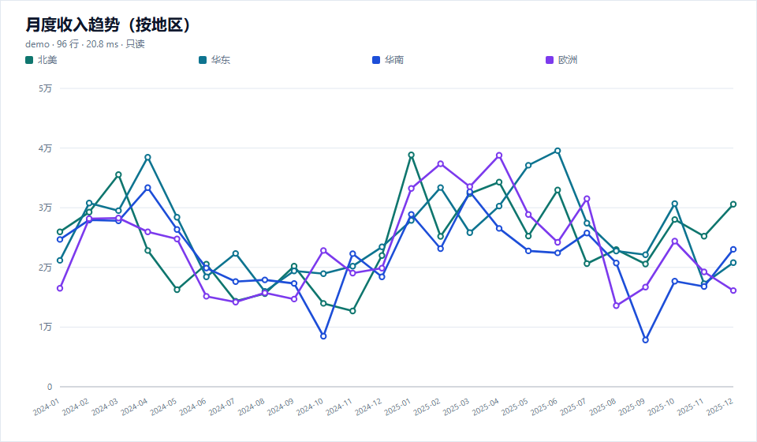
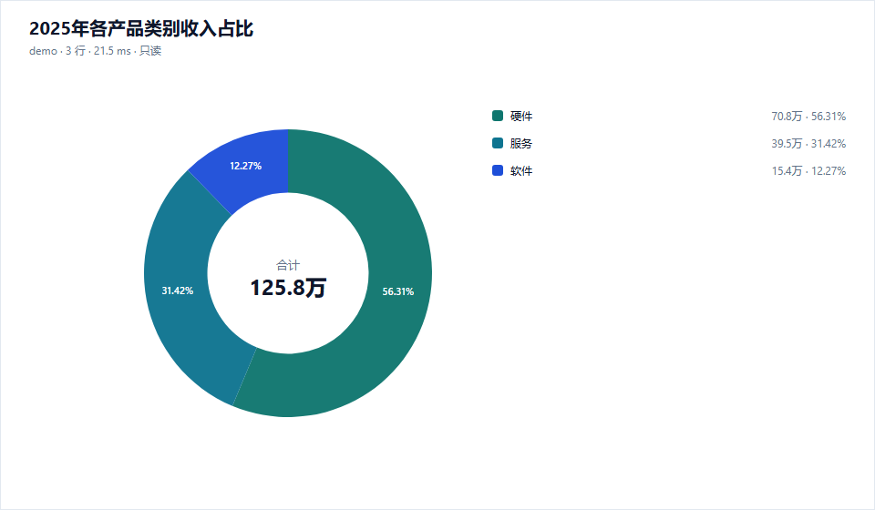

# dsh-data-analyst · 数据透镜

> 数据透镜（Data lens）：对话驱动的数据分析师。一句自然语言问题，自动完成 **理解问题 → 生成 SQL → 安全执行 → 智能选图 → 对话内渲染**，并留下可追溯的审计记录。

`dsh-data-analyst` 是 [DeepSeek Harness](https://github.com/deepseek-ai/deepseek-harness) 的只读数据分析插件。它不替代数据库管理 IDE，也不做底层连接器，而是把“分析闭环”做成一次工具调用：用户提问，模型/插件协作生成一条只读 SQL，执行后用内置 SVG 引擎把结果画在对话流里。


## 预览

插件自带的 SVG 引擎直接输出可嵌入对话的图表（示例数据：`examples/demo.sqlite`）：





## 为什么是“分析闭环”

传统做法需要用户或模型手动串联多个工具：先查 schema，再写 SQL，再执行，再决定图表，再渲染。`db_analyze` 把这五步收进一个入口：

- 自动读取实时 schema（表、列、主键、外键、行数估计）。
- 用当前 DSH 模型把自然语言问题翻译成一条只读 SELECT；也可以直接传入 SQL。
- 三层只读防御后执行，默认 500 行 / 30 秒上限。
- 根据结果形状自动选择折线、柱状、分组/堆叠柱、饼/环、散点、直方图、KPI 或表格。
- 通过本地 HTTP 路由返回 SVG，并在对话内嵌卡片中直接显示。
- 同时返回数据观察、SQL、耗时、截断状态与 `queryId`，方便继续追问。

## 安装

### 从插件市场安装

在 DSH 的 **插件 → 发现** 中搜索 **Data lens / 数据透镜**，安装后重启/刷新页面。

### 本地目录安装

```bash
git clone https://github.com/kken-x/dsh-data-analyst.git dsh-data-analyst
cd dsh-data-analyst
npm install
```

然后在 DSH 的插件管理中选择 **安装本地 bundle**，指向该目录；或让 Agent 调用：

```text
plugin_manager install_bundle target="<absolute path to dsh-data-analyst>"
```

安装完成后刷新 Web GUI。插件包含 Host 与 Client 两部分：Host 注册四个工具、审计与图表路由；Client 把工具结果渲染成内嵌图表卡片。

## 快速开始

### 1. 配置一个只读连接

在插件配置中写入连接。SQLite 是最快的试用方式：

```yaml
connections:
  - name: demo
    driver: sqlite
    database: ./examples/demo.sqlite
    readOnly: true

defaultConnection: demo
maxRows: 500
timeoutMs: 30000
```

仓库自带一个 576 行的销售示例库（`examples/demo.sqlite`）；也可以用 `npm run seed` 重新生成。

PostgreSQL：

```yaml
connections:
  - name: warehouse
    driver: postgres
    host: 127.0.0.1
    port: 5432
    database: analytics
    user: readonly_analyst
    passwordEnv: ANALYTICS_DB_PASSWORD   # 推荐
    # passwordRef: analytics-db-password # 或使用 DSH credentials 服务
    ssl: true
    readOnly: true
```

MySQL：

```yaml
connections:
  - name: ops
    driver: mysql
    host: 127.0.0.1
    port: 3306
    database: ops
    user: readonly_analyst
    passwordRef: ops-db-password
    readOnly: true
```

密码优先级：`passwordRef`（DSH 凭据服务）→ `passwordEnv` → `password`（不推荐）。密码绝不进入日志、审计或工具输出。

### 2. 直接提问

在对话里说：

- “2025 年各地区收入趋势，按月看。”
- “哪个产品类别的退款率最高？画出来。”
- “对比华东和华南的客单价分布。”
- “最近 12 个月收入环比增长是多少？”

Agent 会调用 `db_analyze`，一次完成 SQL、执行、选图与内联渲染。

## 四个工具

| 工具 | 作用 | 什么时候用 |
| --- | --- | --- |
| `db_analyze` | 主入口：自然语言 → SQL → 执行 → 数据观察 → 自动选图 → 内联 SVG | 所有分析型问题首选 |
| `db_profile` | 数据画像：表清单；表级行数、空值率、唯一值、min/max/avg、Top 值、列角色 | 探索 schema、判断数据质量、选维度/指标 |
| `db_query` | 只读查询执行：参数绑定、行数/超时上限、审计、`queryId` | 用户明确给出 SQL，或需要原始行 |
| `db_visualize` | 把 `queryId`、只读 SQL 或内联数据渲染成图表 | 换图、重绘、复用已有结果 |

### `db_analyze`

```json
{
  "question": "2025 年各地区收入对比",
  "connection": "demo",
  "chartType": "auto",
  "maxRows": 500
}
```

返回：

- `sql` / `sqlSource`（`caller` 或 `model`）
- `columns` / `rows` / `rowCount` / `truncated` / `durationMs`
- `chart.type` / `chart.url` / `chart.reason`
- `observations`（可直接用于回答的要点）
- `queryId`（传给 `db_visualize` 换图）

### `db_profile`

不传 `table` 时返回连接的表/列地图：

```json
{ "connection": "demo" }
```

传入表名时返回列级画像：

```json
{ "connection": "demo", "table": "sales", "topValues": 5 }
```

### `db_query`

```json
{
  "connection": "demo",
  "sql": "SELECT region_id, SUM(revenue) AS revenue FROM sales WHERE sale_date >= ? GROUP BY region_id",
  "params": ["2025-01-01"],
  "maxRows": 100
}
```

### `db_visualize`

```json
{ "queryId": "8c194b6874054722a7ac6f3e7410ec60", "chartType": "bar" }
```

`chartType` 可选：`auto`、`line`、`area`、`bar`、`grouped_bar`、`stacked_bar`、`pie`、`donut`、`scatter`、`histogram`、`kpi`、`table`。

## 自动选图规则

| 结果形状 | 默认图表 |
| --- | --- |
| 时间列 + 数值列 | 折线图（多个数值/低基数维度自动多序列） |
| 类别 + 数值 | 柱状图（类别过多降级为表格） |
| 分项占比接近 100% | 环形图（也支持显式 `pie`） |
| 两个类别维度 + 一个数值 | 分组柱状图 |
| 两个数值列 | 散点图 |
| 单一数值列、行数较多 | 直方图 |
| 单行单指标 | KPI 卡片 |
| 空结果/不可绘制的形状 | 表格（Markdown） |

`db_analyze` 还会把模型给出的 `chartType` 当作提示，但最终由结果形状校验；不兼容时会回退并说明原因。

## 三层只读防御

**这不是依赖 DSH 沙箱的安全边界，而是插件自带、可验证的保护。**

### 1. 配置层

- 连接级 `readOnly: true` 是默认值；配置 `readOnly: false` 会让插件拒绝启动。
- 写操作工具根本没有注册；工具集只有四个只读入口。
- SQLite 以 `readOnly: true` 打开；PostgreSQL/MySQL 的每个查询都在 `READ ONLY` 事务中执行。

### 2. 词法层

执行前剥离字符串、注释、引用标识符与 dollar-quoted 文本，然后：

- 只允许单条 `SELECT`、`WITH ... SELECT`、`EXPLAIN`（含 `EXPLAIN QUERY PLAN`）。
- 拒绝多语句、DML、DDL、事务控制、`PRAGMA`、`ATTACH`、`COPY`、`CALL`、`INTO`、`FOR UPDATE`、`LOCK IN SHARE MODE` 等。
- 拒绝 MySQL 可执行注释 `/*! ... */`。
- 拒绝 `pg_read_file`、`pg_ls_dir`、`lo_import`、`dblink`、`load_file`、`nextval`、`load_extension` 等危险函数。

### 3. 执行层

- SQLite 查询在独立 Worker 中执行；超时会 `terminate()`，不会阻塞 Host。
- PostgreSQL 使用 `statement_timeout` + 客户端 `query_timeout`；MySQL 使用 `MAX_EXECUTION_TIME` / `max_statement_time`，异常连接直接销毁。
- 查询在数据库侧被包裹为派生表 `LIMIT maxRows + 1`，避免把百万行拉进内存。
- 密码只从环境变量/DSH 凭据服务解析；错误消息会擦除密码、连接串和字面量。

> 生产环境仍建议使用数据库只读账号，并把 `search_path`/schema 权限限制在分析库。三层防御降低误操作与注入风险，但不是数据库权限模型的替代品。

## 审计

默认写入：

```text
<DSH_PROFILE_DIR>/data/dsh-data-analyst/audit.jsonl
```

如果插件无法获得 `DSH_PROFILE_DIR`，则回退到 `~/.dsh/data/dsh-data-analyst/audit.jsonl`。

每条记录包含：时间、工具名、连接名、SQL 摘要（字面量脱敏）、SQL 哈希、行数、耗时、截断状态、图表类型、状态、错误码、会话 ID。**不记录密码、参数值或结果数据。**

禁用审计：

```yaml
audit:
  enabled: false
```

自定义路径：

```yaml
audit:
  path: ./data/analyst-audit.jsonl
```

## 配置参考

```yaml
connections: []
defaultConnection: ''
maxRows: 500
timeoutMs: 30000

audit:
  enabled: true
  path: ''

sqlGeneration:
  enabled: true
  provider: ''          # 默认使用当前 DSH 模型
  model: ''
  maxOutputTokens: 1400
  maxSchemaTables: 20
  maxSchemaChars: 16000
  timeoutMs: 45000

chart:
  width: 960
  height: 560
  theme: light
  maxCategories: 24

profile:
  maxColumns: 40
  topValues: 5
```

`db_analyze` 的 SQL 生成使用 DSH LLM 服务。若当前模型不可用，可直接传 `sql`，或关闭 `sqlGeneration.enabled` 后由调用方自己写 SQL。

## 图表渲染

- 零图表运行时依赖：内置手写 SVG 渲染器，不引入 ECharts/Canvas。
- 图表通过同源路由 `/dsh-data-analyst/chart/<id>.svg` 提供；只服务内存中 30 分钟内、最多 80 张随机 ID 图表，不接受文件路径。
- Client 半在 `tool.call.toolview` 中注册 `db_analyze` / `db_visualize` 卡片，图表直接出现在对话流中；卡片提供“打开图表”和“复制 SQL”。
- 图表使用独立白底卡片，不依赖 Web 主题；标题、坐标轴、图例均做 XML 转义。

## 限制与路线图

- 只读：没有写回、建表、迁移、权限管理。
- 单条 SQL：不支持脚本、多语句、存储过程。
- 行数/超时上限：默认 500 行 / 30 秒；可通过配置和单次参数调整。
- 自动 SQL 生成受 schema 上下文长度限制；超大 schema 请用 `tables` 聚焦。
- 当前内联卡片是“图表 + SQL/观察”的只读卡片；维度切换、时间范围拖拽等交互式探索在路线图中。

## 开发与测试

```bash
npm install
npm test          # node:test: SQL guard / chart / SQLite / audit
npm run seed      # 重建 examples/demo.sqlite
```

## 发布

```bash
npm publish --access public
```

发布后可在 [Open Plugin Market](https://github.com/polang233/dsh-plugin-index/issues/new?template=plugin-add.yml) 提交收录。市场条目需要：公开源码、可安装的 npm 版本、明确许可证、图标与完善描述。

## License

MIT。见 [LICENSE](LICENSE) 与 [SECURITY.md](SECURITY.md)。
