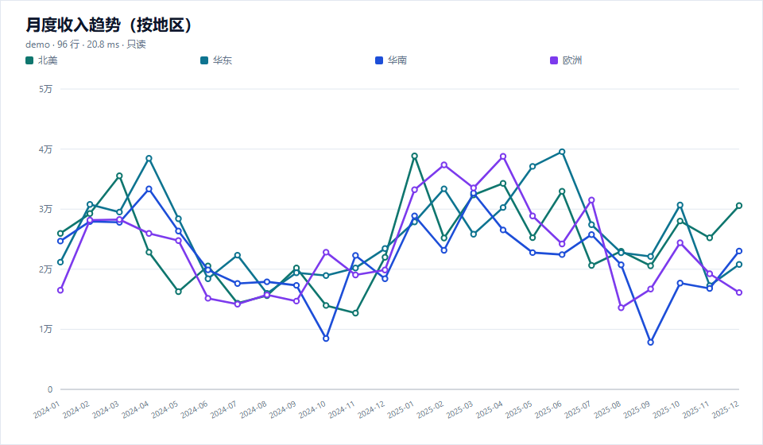
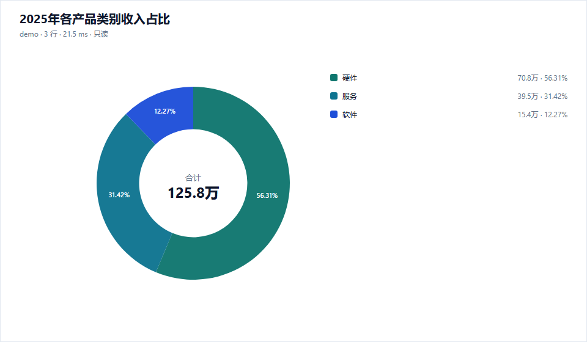

### 插件地址 / Plugin link

https://github.com/kken-x/dsh-data-analyst

固定提交 / fixed commit: `4c944760b98074c30d7b43246d7274d7dda2a492`  
Tag: `v0.1.0`

> npm 包尚未发布（当前环境没有 npm 发布凭据），因此按贡献指南申请 **固定 Git 提交** 收录。源码、`cordis.patch.yml`、Host/Client 入口和许可证均已在仓库中就绪。

### 简短说明 / Summary

**Data lens / 数据透镜** 是 DeepSeek Harness 的对话式只读数据分析师。一次 `db_analyze` 调用完成：理解自然语言问题 → 生成只读 SQL → 安全执行 → 根据结果形状自动选图 → 在对话内嵌 SVG 图表 → 返回数据观察与 `queryId`。另外提供 `db_profile`（数据画像）、`db_query`（只读 SQL）、`db_visualize`（重绘/换图）三个工具。

- 支持 SQLite（Node 内置 `node:sqlite`）、PostgreSQL、MySQL。
- 三层只读防御：连接级 `readOnly`、词法级单条 SELECT 校验、执行级只读事务/Worker 超时终止。
- 默认 500 行 / 30 秒上限；密码支持 `passwordEnv` / DSH `passwordRef`；JSONL 审计不记录密码、参数值或结果数据。
- 零图表运行时依赖，手写 SVG；Client 半在 `tool.call.toolview` 注册内联图表卡片。

### 插件实际效果 / Plugin screenshots

两张图都是插件实际执行的 SQL 结果渲染（示例库 `examples/demo.sqlite`，576 行销售数据）。

### 补充信息 / Additional details

- 包名：`dsh-data-analyst`，版本 `0.1.0`，许可证 MIT。
- 兼容范围：DSH `>=0.2.0-rc.1 <0.3.0-0`；Node `>=22.19`。
- 已验证环境：DSH `0.2.2-rc.1`，Windows 11，Node `22.20.0`。
- 验证：`npm test` 20/20；实际模型生成 SQL、SQLite 执行、自动选图、图表 HTTP 路由 `200 image/svg+xml`、Client toolview 注册均通过；危险 SQL（多语句 / DELETE / 锁定读）被拒绝。
- 安装（Git 提交）：`dsh plugin --profile <profile> add github:kken-x/dsh-data-analyst`
- 收录后 npm 版本可用时会同步更新条目；如必须等待 npm 公开版本，请告知，我可在此 issue 补充 npm 地址。

感谢审核！
